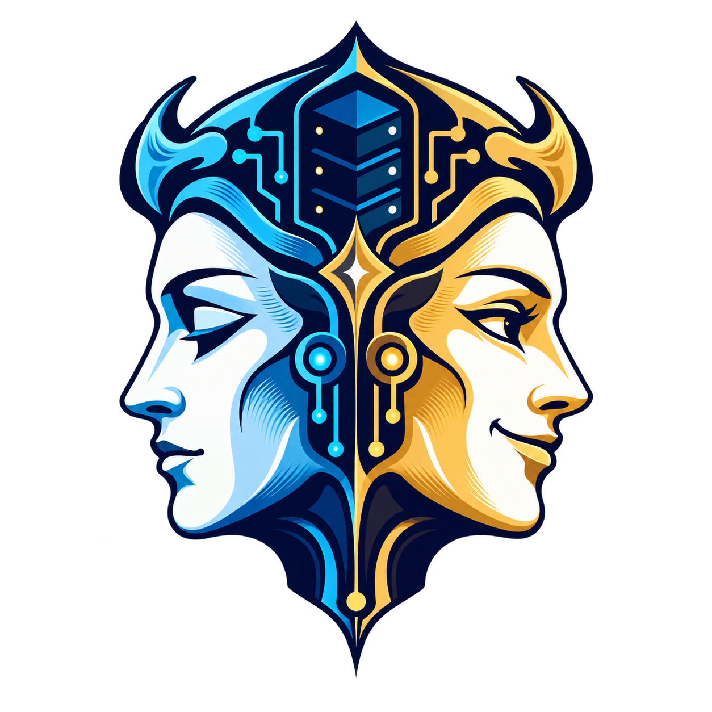
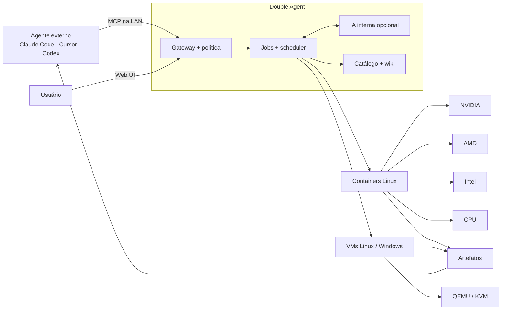
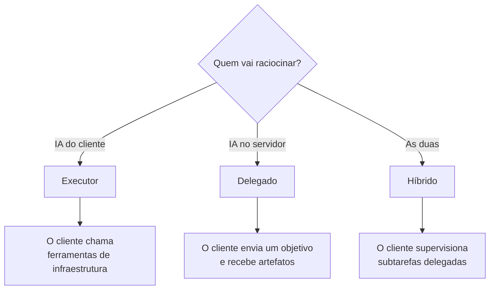
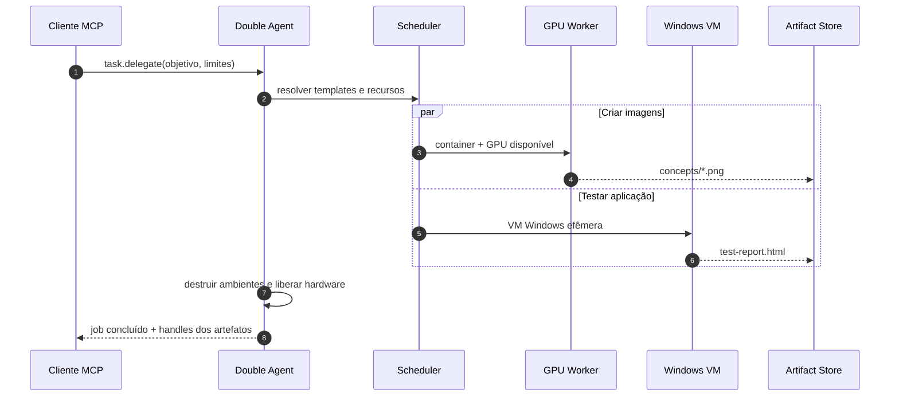
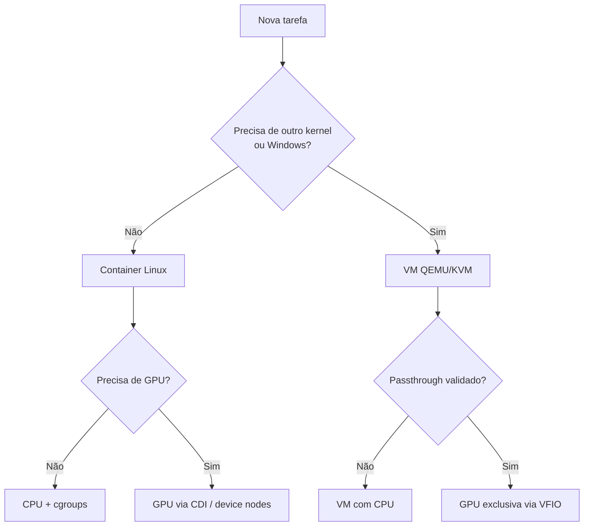
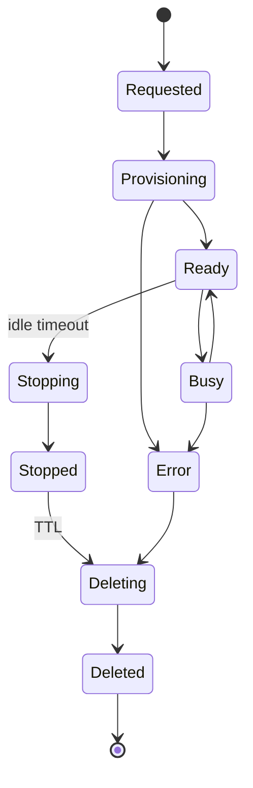
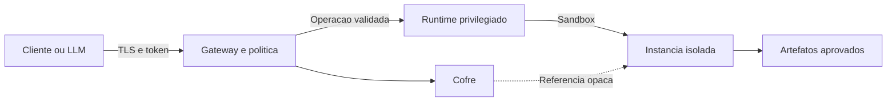
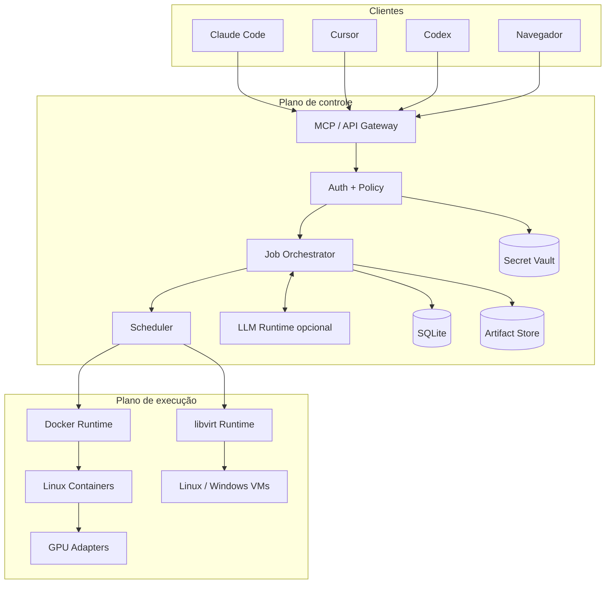

<div align="center">



# Double Agent

### Duas inteligências. Uma infraestrutura. Ambientes infinitamente descartáveis.

[](#estado-do-projeto)
[](docs/MCP_API_AND_DISCOVERY.md)
[](docs/INSTALLATION_AND_OPERATIONS.md)
[](docs/RUNTIMES_GPU_AND_TEMPLATES.md)
[](LICENSE.md)

**Transforme qualquer servidor Linux em uma fábrica local de computadores para agentes de IA.**

Double Agent descobre o hardware disponível, cria containers ou máquinas
virtuais sob demanda, executa tarefas pesadas e devolve os artefatos ao agente
que fez o pedido — sem ocupar a máquina principal do desenvolvedor.

[Visão](docs/VISION_AND_SCOPE.md) ·
[Arquitetura](docs/ARCHITECTURE.md) ·
[MCP](docs/MCP_API_AND_DISCOVERY.md) ·
[GPUs e runtimes](docs/RUNTIMES_GPU_AND_TEMPLATES.md) ·
[Roadmap](docs/MVP_ROADMAP_AND_TEST_PLAN.md)

</div>


> [!IMPORTANT]
> **Double Agent está em fase de arquitetura.** Este repositório contém a
> especificação do produto; os comandos e endpoints apresentados são contratos
> planejados e ainda não representam uma versão instalável.

---

## O problema

Um agente de código consegue escrever software, mas frequentemente não possui:

- GPU para gerar imagens, vídeo ou assets 3D;
- uma máquina Windows para validar o produto;
- um desktop gráfico isolado com Blender ou Chromium;
- CPU e RAM suficientes para builds e testes pesados;
- vários ambientes descartáveis para trabalhar em paralelo;
- permissão para instalar ferramentas na máquina do usuário.

Hoje o desenvolvedor precisa preparar cada ambiente manualmente, expor a própria
máquina ou pagar por serviços diferentes. O Double Agent transforma um servidor
local em uma camada de infraestrutura que qualquer agente autorizado entende.

```text
“Preciso de quatro imagens, um asset Blender e testes no Windows.”

            Agente solicitante
                    │
                    │ MCP
                    ▼
             ┌──────────────┐
             │ Double Agent │
             └──────┬───────┘
                    │
        ┌───────────┼───────────┐
        ▼           ▼           ▼
   GPU worker   Blender VM   Windows VM
        │           │           │
        └───────────┼───────────┘
                    ▼
        imagens · GLB · relatório
```

## A ideia

Double Agent fica entre a IA que pede e o hardware que executa.



Não é apenas um “servidor de IA”. É um **gestor de ambientes efêmeros orientado
a agentes**, capaz de usar uma IA própria ou funcionar como executor puro.

## Por que “Double Agent”?

O produto possui duas faces complementares:

| A face que solicita | A face que executa |
|---|---|
| Entende o objetivo do usuário | Entende o hardware e os runtimes |
| Pode estar no notebook | Vive no servidor local |
| Pode planejar toda a tarefa | Pode receber somente uma intenção |
| Consome ferramentas MCP | Cria, opera e destrói ambientes |
| Quer um resultado | Produz artefatos verificáveis |

O logo combina essas duas identidades em uma única máscara: uma face analítica,
outra operacional, ligadas por infraestrutura e circuitos.

## Três modos de operação



### Executor

O cliente controla diretamente instâncias, comandos, arquivos e jobs. Nenhuma
LLM precisa estar configurada no servidor.

### Delegado

Uma LLM local ou remota configurada no Double Agent recebe um objetivo e decide
quais ambientes e ferramentas usar.

### Híbrido

A IA externa mantém o plano principal e delega trabalhos pesados para a IA do
servidor, acompanhando logs e resultados.

## O que ele poderá fazer

| Capacidade | Exemplo | Resultado |
|---|---|---|
| Geração de imagens | ComfyUI ou engine equivalente com GPU | PNG/WebP + prompt, seed e receita |
| Blender | Modelar, texturizar, renderizar e exportar | `.blend`, `.glb`, `.fbx`, texturas e preview |
| Build e testes | Clonar código e executar pipelines | Logs, cobertura, binários e relatório |
| Desktop Linux | Chromium, terminal e aplicações gráficas | Desktop temporário + downloads |
| Windows | Testar software ou automação de planilhas | Evidências e artefatos exportados |
| Navegador | Executar fluxo web isolado | Screenshots, downloads e relatório |
| Paralelismo | Criar várias instâncias para subtarefas | Jobs independentes e consolidados |

## Um pedido, vários ambientes



## Hardware heterogêneo

O MVP tratará CPU e os três ecossistemas de GPU como capacidades reais,
detectadas e testadas no host.

| Backend | Containers Linux | VMs | Uso esperado |
|---|:---:|:---:|---|
| NVIDIA CUDA/CDI | ✅ MVP | 🧪 VFIO | IA, render, computação |
| AMD ROCm/DRI | ✅ MVP | 🧪 VFIO | IA, render, computação |
| Intel Level Zero/DRI | ✅ MVP | 🧪 VFIO/SR-IOV | IA, OpenVINO, render |
| CPU | ✅ MVP | ✅ MVP | Build, testes e fallback |

> [!NOTE]
> “Suporta AMD/Intel/NVIDIA” não significará apenas detectar um PCI ID.
> `double-agent doctor` executará um smoke-test real e publicará somente as
> capacidades comprovadas para aquela combinação de hardware, kernel e driver.

## Containers quando possível, VMs quando necessário



- **Containers:** rápidos, leves e ideais para IA, Blender, navegadores e builds.
- **VMs Linux:** kernel próprio para testes de sistema e isolamento adicional.
- **VMs Windows:** imagem e licença fornecidas pelo usuário.
- **macOS:** futuro worker em Mac físico; não será emulado ilegalmente num host
  Linux genérico.

## Descoberto automaticamente na rede

O servidor anunciará apenas identidade e endpoint por mDNS:

```text
_double-agent._tcp.local
```

Depois, um bridge local fará pairing e conectará clientes que usam MCP `stdio`:

```bash
# Comandos planejados — ainda não disponíveis
double-agent discover
double-agent pair <server-id>
double-agent connect claude-code
double-agent connect cursor
double-agent connect codex
```

Descobrir não significa confiar. O pairing fixa a CA/fingerprint do servidor e
gera uma credencial revogável.

## MCP que se explica sozinho

Além das ferramentas, o servidor expõe uma wiki como recursos MCP:

```text
doubleagent://wiki/getting-started
doubleagent://wiki/security
doubleagent://wiki/templates
doubleagent://wiki/gpu
doubleagent://jobs/{job_id}
doubleagent://artifacts/{artifact_id}/metadata
```

Ferramentas planejadas:

```text
system.describe          template.list           task.delegate
system.capabilities      instance.create          job.get
system.health            instance.exec            job.logs
artifact.import          instance.destroy         job.cancel
artifact.export          desktop.get_access       image.generate
artifact.get             software.test            blender.create_asset
```

Leia a especificação em [MCP, API e descoberta](docs/MCP_API_AND_DISCOVERY.md).

## Efêmero por padrão



### O que permanece

- sessão e objetivo;
- receita reproduzível;
- versões, digests e passos executados;
- logs sanitizados;
- artefatos exportados;
- cache controlado de imagens e modelos.

### O que desaparece

- disco e overlay da instância;
- `/tmp`, perfil do navegador e memória;
- credenciais transitórias;
- arquivos que não foram exportados;
- tokens de desktop e guest agent.

## Segurança: root no lugar certo

O agente poderá ser root dentro da instância. Ele não receberá:

- socket do Docker/libvirt;
- filesystem, PID namespace ou rede do host;
- dispositivos que não foram alocados;
- banco, cofre ou chave mestra;
- instâncias e artefatos de outros usuários.



Mais detalhes em
[Segurança, persistência e ciclo de vida](docs/SECURITY_STORAGE_AND_LIFECYCLE.md).

## Instalação desejada

```bash
# Contrato futuro; o domínio ainda não existe
curl -fsSL https://<dominio-oficial>/install.sh | sudo bash
```

O bootstrap deverá:

1. detectar host e virtualização;
2. instalar um pacote assinado;
3. perguntar usuário e senha do administrador via TTY;
4. configurar Web UI, CA local e firewall da LAN;
5. detectar Docker, KVM e GPUs;
6. executar smoke-tests;
7. iniciar o daemon e mostrar URL + fingerprint.

Kubernetes será um backend posterior. O instalador do MVP não transformará um
servidor simples em cluster sem necessidade.

## Arquitetura de referência



A especificação detalhada está em [Arquitetura](docs/ARCHITECTURE.md).

## Roadmap

| Fase | Entrega | Demonstração de aceite |
|---:|---|---|
| 0 | Provas de GPU, desktop, VM, MCP e mDNS | Hardware real validado |
| 1 | Vertical slice CPU | Agente executa testes num container e recebe relatório |
| 2 | GPU heterogênea | Mesmo job roda em NVIDIA, AMD e Intel suportadas |
| 3 | Desktop e navegador | Takeover autenticado sem portas expostas |
| 4 | IA interna | Objetivo de alto nível vira múltiplos artefatos |
| 5 | VMs | Linux e Windows efêmeros com exportação |
| 6 | MVP | Instalador, hardening, assinatura e documentação |

Veja critérios e matriz completa em
[MVP, roadmap e testes](docs/MVP_ROADMAP_AND_TEST_PLAN.md).

## Estrutura do repositório

```text
.
├── assets/
│   ├── double-agent-logo.png
│   └── double-agent-hero.png
├── docs/
│   ├── ARCHITECTURE.md
│   ├── DECISIONS_AND_OPEN_QUESTIONS.md
│   ├── INSTALLATION_AND_OPERATIONS.md
│   ├── MCP_API_AND_DISCOVERY.md
│   ├── MVP_ROADMAP_AND_TEST_PLAN.md
│   ├── REFERENCES.md
│   ├── RUNTIMES_GPU_AND_TEMPLATES.md
│   ├── SECURITY_STORAGE_AND_LIFECYCLE.md
│   └── VISION_AND_SCOPE.md
├── LICENSE.md
└── README.md
```

## Decisões importantes

- projeto independente do FeverCode;
- Linux como host do MVP;
- Docker primeiro, libvirt/QEMU para VMs;
- NVIDIA, AMD e Intel validadas em containers Linux;
- Windows com mídia/licença do administrador;
- macOS somente em hardware Apple num backend futuro;
- MCP remoto + bridge `stdio`;
- mDNS para descoberta física na LAN;
- um nó sólido antes de Kubernetes;
- discos efêmeros, receitas e artefatos persistentes;
- código visível sob licença source-available.

As questões ainda abertas estão em
[Decisões e questões abertas](docs/DECISIONS_AND_OPEN_QUESTIONS.md).

## Documentação

| Documento | Conteúdo |
|---|---|
| [Visão e escopo](docs/VISION_AND_SCOPE.md) | Problema, usuários, casos de uso e metas |
| [Arquitetura](docs/ARCHITECTURE.md) | Componentes, dados, estados e evolução para cluster |
| [MCP e descoberta](docs/MCP_API_AND_DISCOVERY.md) | Transporte, bridge, pairing, ferramentas e recursos |
| [Runtimes e GPUs](docs/RUNTIMES_GPU_AND_TEMPLATES.md) | Docker, KVM, vendors, scheduler, templates e cache |
| [Segurança e lifecycle](docs/SECURITY_STORAGE_AND_LIFECYCLE.md) | Confiança, segredos, rede, retenção e ameaças |
| [Instalação e operação](docs/INSTALLATION_AND_OPERATIONS.md) | One-liner, drivers, serviços, backup e atualização |
| [Roadmap e testes](docs/MVP_ROADMAP_AND_TEST_PLAN.md) | Fases, testes de hardware, falhas e Definition of Done |
| [Decisões](docs/DECISIONS_AND_OPEN_QUESTIONS.md) | Decisões confirmadas, limites e dúvidas |
| [Referências](docs/REFERENCES.md) | Fontes oficiais de MCP, GPU, virtualização e licença |

## Estado do projeto

```text
Produto e arquitetura      ████████████████████  documentados
Protocolos e segurança     ████████████████████  especificados
Provas de hardware         ░░░░░░░░░░░░░░░░░░░░  próximas
Implementação              ░░░░░░░░░░░░░░░░░░░░  não iniciada
Release MVP                ░░░░░░░░░░░░░░░░░░░░  futura
```

Este repositório começa deliberadamente pela especificação. Compatibilidade com
GPU, isolamento e lifecycle serão comprovados antes de virarem promessas de
produto.

## Marca e assets

As imagens deste README foram geradas especificamente para o Double Agent. O
conceito visual é original: duas faces teatrais unificadas por uma infraestrutura
central. Não é reprodução de logotipos de óperas, filmes ou outras marcas.

- `assets/double-agent-logo.png` — logo com fundo transparente;
- `assets/double-agent-hero.png` — ilustração horizontal do fluxo do produto.

## Licença

O objetivo comercial informado é permitir leitura e uso próprio, mas impedir
revenda ou redistribuição sem autorização. Isso é **source-available**, não open
source segundo a definição da OSI.

Até a licença definitiva ser revisada juridicamente, todos os direitos
permanecem reservados. Consulte [LICENSE.md](LICENSE.md).

---

<div align="center">


**Double Agent** — dê ao seu agente um computador à altura da tarefa.

</div>

