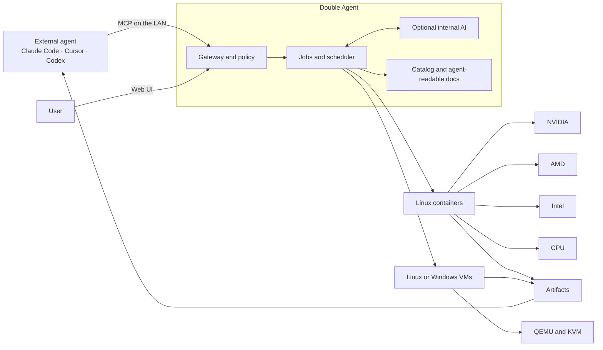
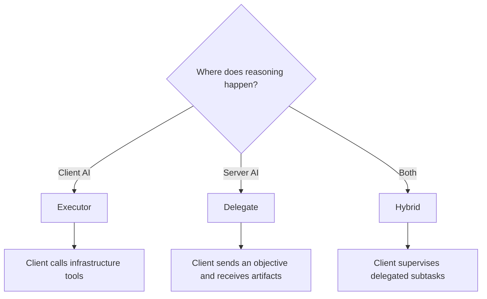
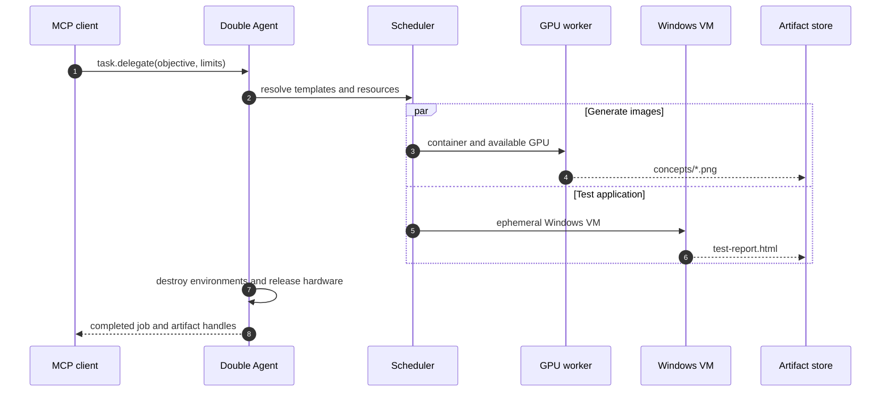
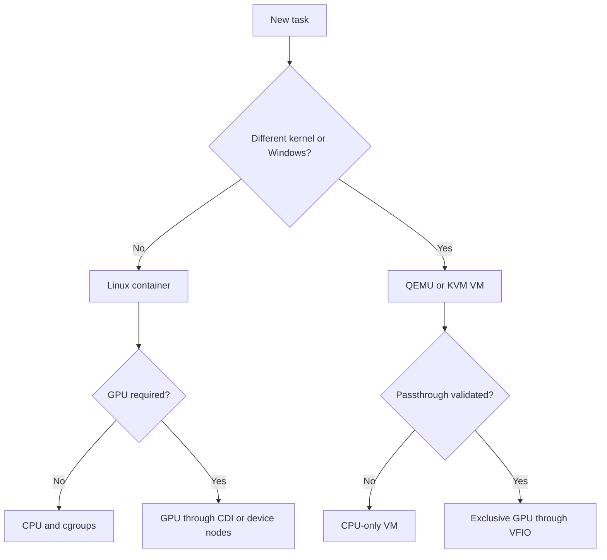
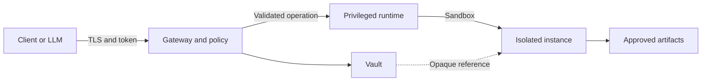
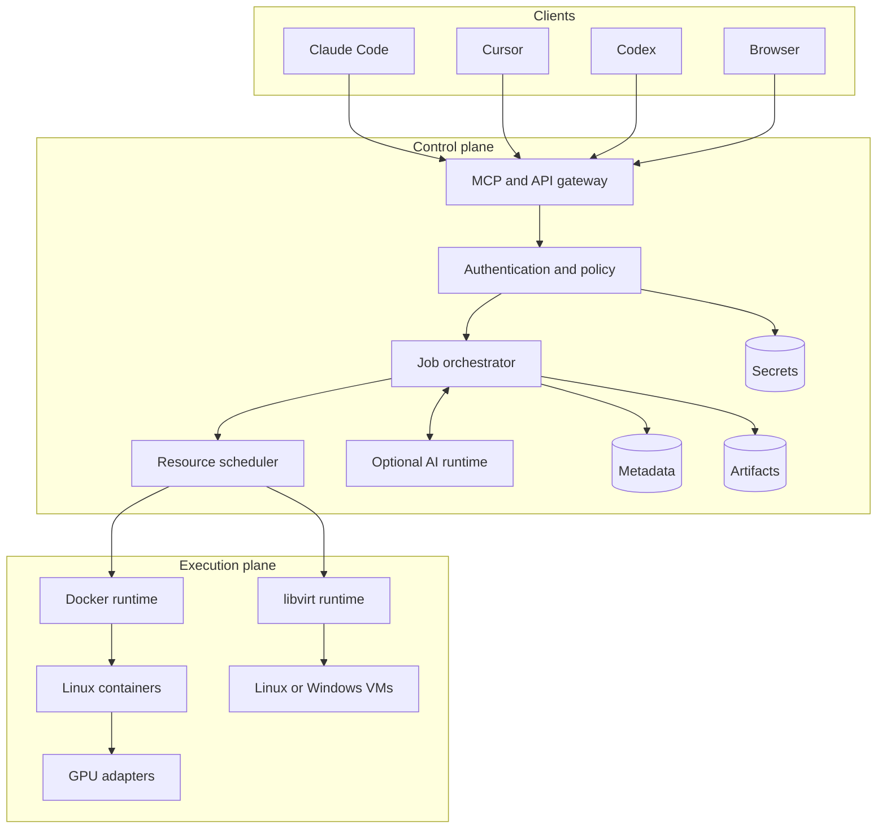

<div align="center">


# Double Agent

### Two intelligences. One infrastructure. Infinitely disposable environments.

[](#project-status)
[](docs/MCP_API_AND_DISCOVERY.md)
[](docs/INSTALLATION_AND_OPERATIONS.md)
[](docs/RUNTIMES_GPU_AND_TEMPLATES.md)
[](docs/I18N.md)

**Turn any Linux server into a local factory of computers for AI agents.**

Double Agent discovers available hardware, creates containers or virtual
machines on demand, performs compute-heavy work, and returns artifacts to the
requesting agent—without occupying the developer's primary computer.

[Vision](docs/VISION_AND_SCOPE.md) · [Architecture](docs/ARCHITECTURE.md) ·
[MCP](docs/MCP_API_AND_DISCOVERY.md) · [GPU and runtimes](docs/RUNTIMES_GPU_AND_TEMPLATES.md) ·
[Roadmap](docs/MVP_ROADMAP_AND_TEST_PLAN.md) · [Build plan](docs/BUILD_PLAN.md) · [Pilot checklist](docs/PILOT_READINESS.md) · [Português](README.pt-BR.md)

</div>


> [!IMPORTANT]
> **Double Agent is an unvalidated pre-release control plane.** The repository
> now includes a Go daemon, MCP server, Web UI, Docker runtime, and Proxmox VM
> runtime. These are implemented code paths, but no clean-host, real-Proxmox,
> or hardware validation has been recorded yet. Do not treat it as production
> infrastructure; use the [pilot checklist](docs/PILOT_READINESS.md) first.

---

## The problem

Coding agents can write software, but they often lack:

- a GPU for image, video, or 3D asset generation;
- a Windows machine for product validation;
- an isolated graphical desktop with Blender or Chromium;
- enough CPU and memory for large builds and test suites;
- multiple disposable environments for parallel work;
- permission to install tools on the user's computer.

Double Agent turns a local server into an infrastructure layer that any
authorized agent can understand and operate.

```text
"I need four images, one Blender asset, and a Windows test run."

              Requesting agent
                     │
                     │ MCP
                     ▼
              ┌──────────────┐
              │ Double Agent │
              └──────┬───────┘
                     │
         ┌───────────┼───────────┐
         ▼           ▼           ▼
    GPU worker   Blender VM   Windows VM
         │           │           │
         └───────────┼───────────┘
                     ▼
          images · GLB · report
```

## The idea

Double Agent sits between the intelligence requesting work and the hardware
performing it.



This is not only an AI server. It is an **agent-oriented ephemeral environment
manager** that can run its own optional AI or act as a pure executor.

## Why “Double Agent”?

| The requesting face | The executing face |
|---|---|
| Understands the user's outcome | Understands hardware and runtimes |
| May live on a laptop | Lives on the local server |
| May plan the entire task | May receive only an objective |
| Consumes MCP tools | Creates, operates, and destroys environments |
| Wants a result | Produces verifiable artifacts |

The two-faced theatrical mask represents these complementary identities.

## Three operating modes



- **Executor:** the client directly controls instances, commands, files, and jobs.
- **Delegate:** an optional local or remote LLM receives an objective and chooses tools.
- **Hybrid:** the external AI owns the plan and delegates heavy subtasks.

## What it is designed to do

| Capability | Example | Output |
|---|---|---|
| Image generation | ComfyUI or equivalent GPU engine | PNG/WebP, prompt, seed, recipe |
| Blender | Model, texture, render, and export | `.blend`, `.glb`, `.fbx`, textures, preview |
| Build and test | Clone code and execute pipelines | Logs, coverage, binaries, report |
| Linux desktop | Chromium, terminal, graphical apps | Temporary desktop and downloads |
| Windows | Software testing or spreadsheet automation | Evidence and exported artifacts |
| Browser | Isolated Web workflow | Screenshots, downloads, report |
| Parallelism | Multiple instances for independent subtasks | Consolidated job results |

## One request, multiple environments



## Heterogeneous hardware

| Backend | Linux containers | VMs | Primary use |
|---|:---:|:---:|---|
| NVIDIA CUDA/CDI | ✅ MVP | 🧪 VFIO | AI, rendering, compute |
| AMD ROCm/DRI | ✅ MVP | 🧪 VFIO | AI, rendering, compute |
| Intel Level Zero/DRI | ✅ MVP | 🧪 VFIO/SR-IOV | AI, OpenVINO, rendering |
| CPU | ✅ MVP | ✅ MVP | Builds, tests, fallback |

Support means a real smoke test passes for the exact hardware, kernel, and
driver combination—not merely that a PCI vendor ID was detected.

## Runtime selection



## LAN discovery and MCP connection

The daemon advertises `_double-agent._tcp.local` through mDNS. A small bridge
can pair with the server and expose `stdio` MCP for clients that do not support
remote Streamable HTTP directly.

```text
$ double-agent discover
NAME          ADDRESS             GPU                STATUS
studio-node   192.168.1.40:7443   Intel Arc A770     ready

$ double-agent pair studio-node
Fingerprint: SHA256:...
Pairing code: 482 117

$ double-agent connect cursor
Client configured successfully.
```

LAN broadcast is discovery, not authentication. Every request still requires
TLS, a revocable credential, scopes, quotas, and policy evaluation.

## Planned MCP surface

```text
capabilities.get       template.list          instance.create
instance.exec          instance.destroy       file.upload.begin
artifact.export        artifact.download      job.get
job.cancel             desktop.open           task.delegate
```

Long operations return `job_id` handles. Large outputs are transferred as
authenticated artifacts rather than oversized MCP payloads. Agent-readable
resources under `double-agent://docs/*` describe tools, templates, limits, and
examples. See [MCP API and discovery](docs/MCP_API_AND_DISCOVERY.md).

## Security boundary

An agent may be root inside its instance. It does not receive the host runtime
socket, host filesystem, host PID namespace, unallocated devices, raw secrets,
or access to other users' instances and artifacts.



## Desired installation experience

```bash
curl -fsSL https://install.double-agent.dev | sudo sh
```

The installer will verify its signature, inspect the host, create the service
account, prompt for the first administrator, generate local TLS material,
detect Docker/KVM/GPUs, run smoke tests, and print the Web UI URL and fingerprint.
It will never install GPU drivers or enable virtualization without explicit approval.

## Reference architecture



## Internationalization

English is the canonical language for code, APIs, logs, documentation, and the
default Web UI. The Web preview includes a language selector, browser-locale
detection, persisted preference, and an English fallback. Brazilian Portuguese
is the first translation. See [Internationalization](docs/I18N.md).

| Surface | Default | Localization strategy |
|---|---|---|
| Code, schemas, API fields | English only | Stable machine-facing contract |
| Logs and audit events | English only | Searchable operational vocabulary |
| Web UI | English | Translation catalogs and language selector |
| Human documentation | English | Versioned translations under `docs/<locale>` |
| MCP descriptions | English | Optional locale negotiation later |

Open the preview locally:

```bash
python3 -m http.server 8080
```

Then visit `http://localhost:8080/web/`.

Validate documentation and locale catalogs with:

```bash
node scripts/check-docs.mjs
node web/test-i18n.mjs
```

## Repository map

```text
.
├── README.md                 # Canonical English overview
├── README.pt-BR.md           # Brazilian Portuguese overview
├── assets/                   # Brand and architecture artwork
├── docs/                     # Canonical English specifications
│   ├── I18N.md
│   └── pt-BR/                # Portuguese specification snapshot
└── web/                      # Multilingual Web UI preview
    ├── index.html
    ├── app.js
    ├── styles.css
    └── locales/
```

## Roadmap snapshot

| Phase | Outcome | Status |
|---|---|---|
| 0 | Hardware probes and technical proofs | Not yet evidenced on a target host |
| 1 | CPU vertical slice, MCP, artifacts | Implemented in code; environment validation pending |
| 2 | NVIDIA, AMD, and Intel GPU support | Planned |
| 3 | Desktop and browser workers | Planned |
| 4 | Optional internal AI and delegation | Planned |
| 5 | Linux VM lifecycle through Proxmox | Implemented in code; target validation pending |
| 5 | Windows VM workflow and VFIO | Planned |
| 6 | Hardened MVP release | Planned |

## Project status

The repository is an early implementation plus its product specification. It
is ready for a controlled single-host pilot after the documented checks pass.
It is not yet ready to install on a production server or expose to the
internet.

## License

The current repository is **source-available**, not OSI open source. Viewing
and evaluating the source is permitted; redistribution, resale, sublicensing,
and commercial hosting require written authorization. See [LICENSE.md](LICENSE.md).

---

<div align="center">

**Double Agent** — ask once, provision what is needed, keep only the result.

</div>
