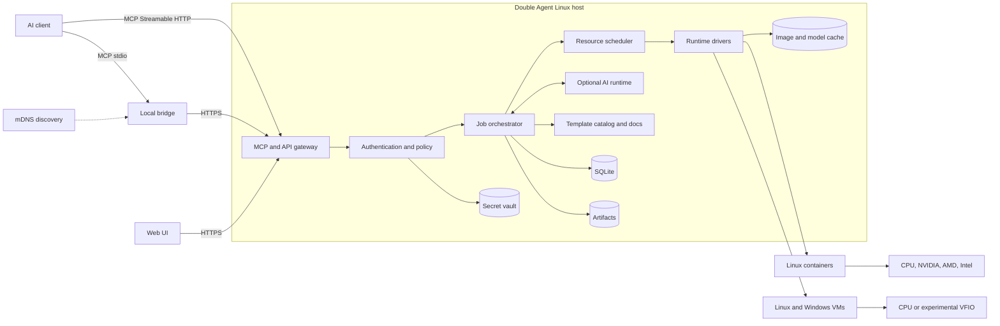

# Architecture

## Overview

Double Agent separates control, execution, and data planes. This allows the
product to begin on one node and later add workers or Kubernetes without
changing its MCP contract.



## `double-agentd`

The daemon should be written in Go to produce a compact static binary, embed
the Web UI, integrate with Docker and libvirt, serve HTTP and mDNS, and simplify
one-line installation.

Responsibilities:

- CPU, memory, storage, and GPU inventory;
- MCP gateway and Web API;
- authentication, authorization, quotas, and policy;
- scheduling, lifecycle, and reconciliation;
- container and VM runtime adapters;
- metadata, audit, secrets, caches, and artifacts;
- optional internal AI supervision;
- LAN discovery.

The daemon never runs arbitrary user commands directly on the host. Execution
occurs inside a runtime instance through a guest agent or runtime `exec` API.

## Web UI

A TypeScript/React application will be embedded in the daemon. The MVP screens
cover bootstrap, hardware health, jobs, sessions, instances, consoles,
templates, artifacts, LLM providers, users, keys, quotas, secrets, audit, and
diagnostics. English is the fallback language; catalogs provide localization.

## Network surface

| Path | Purpose |
|---|---|
| `/mcp` | Remote MCP transport |
| `/api/v1/*` | Private API for Web UI and CLI |
| `/artifacts/*` | Authenticated temporary downloads |
| `/desktop/*` | Authenticated desktop proxy or connection data |
| `/docs` | Human documentation |

MCP is the agent interface. The private REST API is not a replacement for MCP.

## Jobs and scheduler

Every long-running operation creates a `job_id`. A job records intent,
requester, template, resources, logs, artifacts, cost, and state. The scheduler
enforces host reserves, exclusive device locks, compatible GPU sharing, client
quotas, priorities, and template/runtime/hardware compatibility.

The MVP has one node, but domain objects include `node_id` from the start.

## Runtime contract

```go
type Runtime interface {
    Prepare(ctx context.Context, recipe Recipe) error
    Create(ctx context.Context, spec InstanceSpec) (Instance, error)
    Start(ctx context.Context, id InstanceID) error
    Exec(ctx context.Context, id InstanceID, req ExecRequest) (ExecHandle, error)
    Console(ctx context.Context, id InstanceID) (ConsoleEndpoint, error)
    CopyIn(ctx context.Context, id InstanceID, src ArtifactRef, dst GuestPath) error
    CopyOut(ctx context.Context, id InstanceID, src GuestPath) (ArtifactRef, error)
    Stop(ctx context.Context, id InstanceID, grace time.Duration) error
    Destroy(ctx context.Context, id InstanceID) error
    Inspect(ctx context.Context, id InstanceID) (ObservedState, error)
}
```

Planned implementations are Docker first, libvirt/QEMU/KVM second,
Kubernetes later, and a possible physical Apple worker in the future.

## Guest agent

VMs use a small authenticated guest agent for commands, files, and telemetry.
The preferred channel is `virtio-serial` or vsock, never an unauthenticated LAN
port. Containers use runtime APIs and a minimal supervisor.

## Optional AI runtime

The internal AI is not on the pure-executor critical path. Adapters initially
target OpenAI-compatible local endpoints and hosted providers. It receives only
job-scoped tools and opaque secret references. Audit records distinguish client
actions from decisions made by the internal AI.

## Data classes

1. **Small state:** SQLite, configuration, sessions, recipes, and audit events.
2. **Rebuildable cache:** OCI images, packages, and models.
3. **User data:** inputs and exported artifacts with retention policies.

Instance disks are ephemeral and excluded from backups by default.

## Core entities

| Entity | Purpose |
|---|---|
| `User` | Local administrator or user |
| `ApiKey` | Revocable credential with scopes and quotas |
| `Node` | Execution host |
| `Device` | Discovered and tested capability |
| `Template` | Versioned environment definition |
| `Recipe` | Resolved, reproducible execution plan |
| `Session` | Logical continuity between requests |
| `Job` | Observable asynchronous operation |
| `Instance` | Concrete disposable container or VM |
| `Artifact` | Controlled exported file |
| `Secret` | Encrypted value referenced by identifier |
| `AuditEvent` | Security and operational evidence |

## State machines

Jobs progress through `queued → preparing → running → exporting → completed`,
with `failed`, `canceled`, and `expired` terminal paths. Instances progress
through `requested → preparing → starting → ready → stopping → destroyed`.
Reconciliation must safely resume or clean up intermediate states after restart.

## Deployment evolution

The first release is a single Linux node with SQLite and local storage. A later
multi-node design introduces a node agent, mTLS, object storage, distributed
scheduling, and an external database without changing tool semantics.
