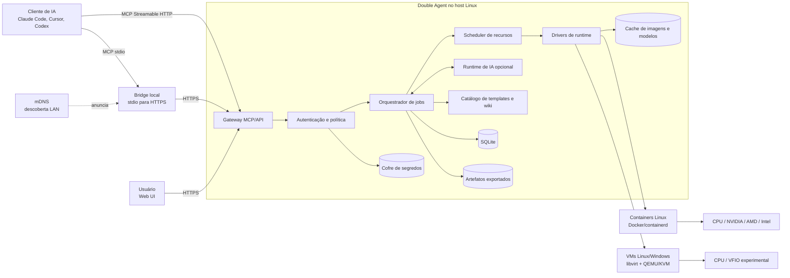

# Arquitetura

## 1. Visão geral

O Double Agent separa claramente o plano de controle, o plano de execução e o
plano de dados. Essa separação permite começar em um nó e acrescentar workers
ou Kubernetes sem alterar a interface MCP.



## 2. Componentes

### `double-agentd`

Daemon privilegiado apenas no que for necessário para administrar runtimes e
dispositivos. Recomendação: Go para produzir binário estático, integrar APIs de
Docker/libvirt, servir HTTP e mDNS e simplificar a instalação.

Responsabilidades:

- inventário de CPU, memória, disco e GPU;
- gateway MCP e API da Web UI;
- autenticação e autorização;
- scheduler e lifecycle;
- drivers de containers e VMs;
- metadados, auditoria, segredos e cache;
- supervisão da IA interna opcional;
- anúncio mDNS.

O daemon não executa diretamente comandos de usuário no host. Toda execução
ocorre numa instância por meio de um agente de guest ou `exec` do runtime.

### Web UI

Aplicação estática em TypeScript/React incorporada ao binário do daemon. Isso
mantém a instalação em um pacote e evita um servidor Node separado.

Telas do MVP:

- login e bootstrap;
- dashboard de CPU, RAM, disco e GPUs;
- jobs e sessões;
- instâncias, consoles e destruição;
- templates e validações;
- artefatos;
- provedores/LLMs e modelos locais;
- usuários, chaves, cotas e segredos;
- eventos de auditoria e diagnóstico.

### Gateway MCP/API

O mesmo servidor HTTPS publica:

- `/mcp`: MCP remoto;
- `/api/v1/*`: API privada usada pela Web UI e CLI;
- `/artifacts/*`: downloads temporários e autenticados;
- `/desktop/*`: proxy ou informações de conexão para desktop;
- metadados de autorização e Server Card;
- documentação humana em `/docs`.

MCP é a interface de agentes; a API REST não deve ser tratada como substituta
do protocolo.

### Orquestrador de jobs

Toda operação demorada cria um `job_id`. O job registra intenção, solicitante,
template, recursos, logs, artefatos, custo e estado. O transporte MCP atual é
tratado como stateless; o identificador explícito mantém continuidade.

### Scheduler

Seleciona CPU, RAM, disco, runtime e dispositivos. No MVP há apenas um nó, mas
o contrato recebe `node_id` desde o início.

Regras mínimas:

- nenhuma alocação excede a reserva do host;
- GPU inteira fica bloqueada quando atribuída por passthrough;
- containers podem compartilhar GPU somente quando o driver permite e a
  política autoriza;
- prioridade e cotas evitam que um cliente ocupe todo o host;
- jobs aguardam em fila quando recursos não estão disponíveis;
- scheduler conhece compatibilidade entre template, runtime, arquitetura e
  backend de GPU.

### Drivers de runtime

```go
type Runtime interface {
    Prepare(ctx, Recipe) error
    Create(ctx, InstanceSpec) (Instance, error)
    Start(ctx, InstanceID) error
    Exec(ctx, InstanceID, ExecRequest) (ExecHandle, error)
    Console(ctx, InstanceID) (ConsoleEndpoint, error)
    CopyIn(ctx, InstanceID, ArtifactRef, GuestPath) error
    CopyOut(ctx, InstanceID, GuestPath) (ArtifactRef, error)
    Stop(ctx, InstanceID, GracePeriod) error
    Destroy(ctx, InstanceID) error
    Inspect(ctx, InstanceID) (ObservedState, error)
}
```

Implementações planejadas:

1. `docker`: backend inicial para Linux;
2. `libvirt`: Linux/Windows em QEMU/KVM;
3. `kubernetes`: backend posterior;
4. `apple-worker`: futuro backend remoto para Macs físicos.

### Guest Agent

Pequeno agente dentro das VMs para execução, arquivos e telemetria. Deve usar
canal autenticado e específico da instância, preferencialmente `virtio-serial`
ou vsock em vez de uma porta aberta na LAN. Containers usam API do runtime e
um supervisor mínimo.

### Runtime de IA opcional

Não faz parte do caminho crítico do executor puro. Possui adaptadores:

- OpenAI-compatible para Ollama, vLLM, LM Studio e provedores compatíveis;
- OpenAI hospedado;
- adaptadores nativos adicionais depois do primeiro vertical slice.

Ele recebe ferramentas limitadas ao job e nunca credenciais brutas. O
orquestrador registra quais decisões vieram da IA interna e quais vieram do
cliente externo.

## 3. Planos de controle, execução e dados

### Plano de controle

Web UI, MCP, autenticação, scheduler, jobs, metadados e auditoria. Precisa
continuar operacional mesmo se Docker ou libvirt falharem.

### Plano de execução

Containers, VMs, processos, desktops e GPU. Pode ser reiniciado e reconciliado
com o estado desejado no banco.

### Plano de dados

Três classes distintas:

1. **estado pequeno:** SQLite, configurações, sessões, receitas e auditoria;
2. **cache reconstruível:** imagens OCI, pacotes e modelos;
3. **dados do usuário:** inputs e artefatos exportados com política de retenção.

Discos de instância são efêmeros e não entram em backup por padrão.

## 4. Modelo de domínio

| Entidade | Propósito |
|---|---|
| `User` | Administrador ou usuário local |
| `ApiKey` | Credencial revogável com escopos e cotas |
| `Node` | Host de execução; um no MVP |
| `Device` | CPU, GPU, armazenamento ou capacidade detectada |
| `Template` | Definição versionada de ambiente e capacidades |
| `Recipe` | Plano resolvido e reproduzível para uma execução |
| `Session` | Continuidade lógica entre cliente e objetivos |
| `Job` | Operação assíncrona observável |
| `Instance` | Container ou VM concreta e descartável |
| `Artifact` | Arquivo exportado e controlado |
| `Secret` | Valor cifrado referenciado por identificador |
| `AuditEvent` | Registro append-only de ação relevante |

## 5. Máquinas de estado

### Job

```text
queued -> planning -> preparing -> running -> exporting -> succeeded
   |          |           |           |            |
   +----------+-----------+-----------+------------+-> failed
                          `---------------------------> cancelled
```

### Instância

```text
requested -> provisioning -> ready -> busy -> stopping -> stopped -> deleting -> deleted
                    |          |       |          |
                    `----------+-------+----------+-> error
```

Estados são idempotentes. Após reinício, um reconciliador compara banco e
runtime, marca recursos órfãos e conclui destruições pendentes.

## 6. Fluxos principais

### Executor puro

1. cliente chama `instance.create`;
2. servidor valida chave, cotas e template;
3. scheduler reserva recursos;
4. runtime cria a instância;
5. cliente usa `instance.exec` e `artifact.import`;
6. cliente exporta resultados;
7. servidor destrói no fim do TTL.

### Delegação para IA interna

1. cliente chama `task.delegate` com objetivo e limites;
2. servidor cria job e contexto de ferramentas;
3. IA interna seleciona template ou cria receita derivada;
4. cada ação passa pelas mesmas políticas do executor puro;
5. progresso e logs ficam disponíveis;
6. servidor retorna resumo estruturado e artefatos.

### Intervenção humana

1. job pede login, seleção visual ou confirmação;
2. estado vira `input_required`;
3. Web UI oferece desktop temporário;
4. usuário conclui a etapa;
5. job retoma sem expor a senha ao modelo quando possível.

## 7. Concorrência

- fila persistente no SQLite no MVP;
- workers internos com leases e heartbeat;
- locks de dispositivo para GPU e passthrough;
- limites por usuário e por host;
- cancelamento cooperativo, seguido de encerramento forçado após grace period;
- idempotency key em chamadas de criação para evitar instâncias duplicadas.

## 8. Evolução para cluster

O daemon único será dividido logicamente desde o início:

```text
gateway/scheduler -> worker protocol -> node agent -> runtime
```

No MVP, o worker protocol pode ser uma chamada interna. No cluster, torna-se
mTLS entre o controlador e agentes de nó. Kubernetes implementa `Runtime`, mas
não substitui sessões, políticas, artefatos ou MCP.

